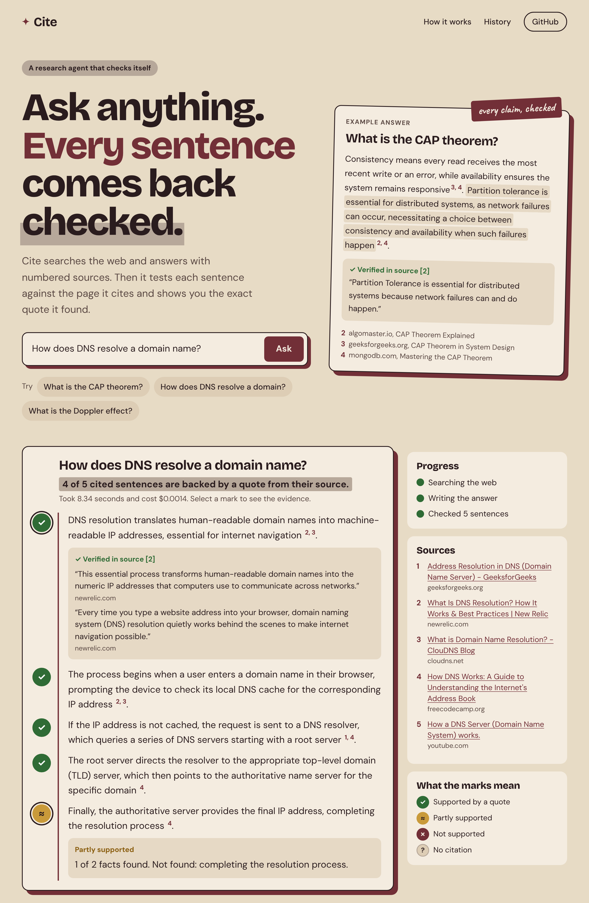
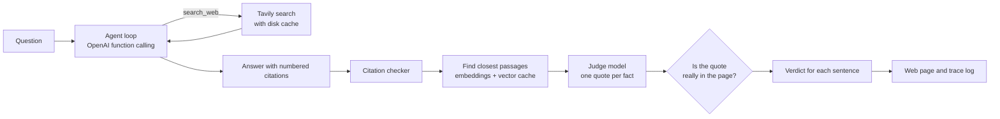

# Cite


A research agent that answers a question with numbered sources, then checks every sentence against the page it cites.



*A real answer from the fresh question eval, shown in the web app. Select a mark to see the quote the checker found, or why it found none.*

## The problem

Research agents write fluent answers with citations that look right. Often the cited page does not say what the sentence claims. The reader has to open every link to find out.

## The result

Cite answers a question, then tests each cited sentence. For every fact in the sentence, a second model must copy an exact quote from the source, and plain code checks that the quote really appears in the page. Sentences are labeled supported, partly supported, not supported, bad citation or no citation, and supported ones show their quote.

Measured numbers are in the [Results](#results) section.

## One hard decision

My first checker asked a model "is this sentence supported?" and trusted the answer. On a real run it marked a sentence about CSV files, servers and "SQLite for analytics" as supported because of one quote about "traditional database setups". The quote was real, but it covered only a small part of the sentence.

Now the judge must split each sentence into separate facts and quote evidence for every one. Code checks each quote against the page text, so a made up quote is rejected. A sentence counts as supported only if every fact has a real quote. This is stricter, so it marks more sentences as partly supported. I chose that on purpose, because a checker that approves weak evidence is worse than no checker.

## How the parts fit together



## What is in the repo

| File | What it does |
|---|---|
| `cite/agent.py` | The agent loop. The model can call one tool, `search_web`. Step limit and a spending cap per question. |
| `cite/search.py` | Tavily search. Every result is cached on disk, so repeated questions cost nothing. |
| `cite/checker.py` | The citation checker described above. |
| `cite/retrieval.py` | Finds the passages of a cited page that a sentence is about: by embeddings (default), by shared words, or both. Page vectors are cached on disk. |
| `cite/pipeline.py` | Runs one question from search to verdict. Used by the command line, the server and the evals. |
| `cite/api.py` | FastAPI server that streams progress live. Rate limit per address and a daily spending cap. |
| `cite/evals.py` | The two evals. |
| `web/index.html` | One page, no framework. The answer sits on a sheet with a margin of proof marks, one per sentence, and each mark opens the quote that backs it. |
| `cite/trace.py` | Saves every question and result to a daily log file. |

## Run it

```bash
python3 -m venv .venv
source .venv/bin/activate
pip install -r requirements.txt
pip install -r requirements-rag.txt   # embedding retrieval (optional, falls back to word matching)
cp .env.example .env          # add your OpenAI and Tavily keys
python -m cite.check          # prints yes or no for each key
python -m pytest -q           # no network needed
python -m cite.ask "What is the CAP theorem?"
python -m cite.api            # then open http://127.0.0.1:8000
```

## Results

Two evals, both repeatable with one command. Model: gpt-4o-mini, temperature 0.

<!-- RESULTS:START -->
**Citation checker on planted errors** (20 passages, 80 wrong claims, 20 true claims)

| Kind of error | Caught |
|---|---|
| Wrong number | 20 of 20 (100%) |
| Wrong name | 18 of 20 (90%) |
| Extra fact the source does not state | 20 of 20 (100%) |
| Negation | 20 of 20 (100%) |
| **All planted errors** | **78 of 80 (98%)** |
| True claims accepted | 20 of 20 (100%) |

**Agent on 30 questions**

| Measure | Result |
|---|---|
| Cited sentences fully supported | 125 of 142 (88%) |
| Answers where every sentence was supported | 17 of 30 |
| Sentences with no citation | 0 |
| Searches per question | 1.03 |
| Time per question (median, slowest 5%) | 6.99 s, 10.13 s |
| Cost per question | $0.00142 |

**Agent on 20 fresh questions** (run once after the last change, never tuned on)

| Measure | Result |
|---|---|
| Cited sentences fully supported | 76 of 91 (84%) |
| Answers where every sentence was supported | 8 of 20 |
| Sentences with no citation | 0 |
| Time per question (median, slowest 5%) | 9.42 s, 14.26 s |
| Cost per question | $0.00146 |
<!-- RESULTS:END -->

**Planted errors** (`make planted`). Twenty short passages about made up people, places and products, so the judge cannot use what it already knows. For each passage there is one true sentence and four sentences with a planted error: a wrong number, a wrong name, an extra fact the passage does not state, and a negation. The eval counts how many wrong sentences the checker catches and how many true sentences it wrongly rejects. This is a synthetic test, so it shows how the checker behaves, not how it will do on every page on the web.

**Thirty questions** (`make questions`). The whole agent answers 30 general questions. The checker grades these answers, so the number is only as trustworthy as the planted error result above. I have not read every flagged sentence against its page by hand, so some flags may be checker mistakes rather than wrong answers.

### How the numbers changed

| Version | Planted errors caught | True claims accepted | Sentences supported (30 questions) | Median time |
|---|---|---|---|---|
| 1. Judge says yes or no, quote checked | 73 of 80 (91%) | 18 of 20 | 116 of 146 (79%) | 18.9 s |
| 2. Added number, name and "not" checks, fixed sentence splitting, parallel checks | 78 of 80 (98%) | 19 of 20 | 119 of 142 (84%) | 9.7 s |
| 3. Narrower "not" check, U.S. equals United States, judge sees 8 passages instead of 4 | 78 of 80 (98%) | 19 of 20 | 123 of 143 (86%) | 6.9 s |
| 4. Short quotes accepted when they carry a real word or a number | 78 of 80 (98%) | 20 of 20 | 125 of 142 (88%) | 7.0 s |

Version 1 missed seven planted errors. In four of them the judge quoted a real line that said something different, for example "640 metres" for a claim of 460 metres. Version 2 compares numbers, names and "not" in code. The first run also showed two bugs of mine: a sentence was cut after "Dr.", and a comma broke a quote match.

Reading the flagged sentences from the 30 question run showed three kinds. Some are real: the model added a detail that its cited pages do not contain, such as "Balkans". Some were false alarms from my own rules: a "not" check that fired on "cannot" and "without", "United States" against "U.S.", and a rule that rejected every quote shorter than 15 characters, which threw out real evidence like "self healing" and "in 1989". The rest were cases where the judge only saw a few short passages of a long page.

I changed the checker after reading failures from these same 30 questions, so the 88% is measured on a set I tuned against. The planted error result did not drop while I made these changes, which is the guard against simply making the checker looser. To test that, I wrote 20 new questions after the last change and ran them once, with no changes afterwards. Those are the fresh question results above. They scored lower than the tuning set (84% against 88%), which is what you would expect after tuning on the first set, so 84% is the number I trust.

### Finding evidence by meaning

The judge only sees 8 passages from each cited page, so the step that picks those passages decides what evidence it can find. The first version picked passages that shared the most words with the sentence. That misses a page that says the same thing in other words.

Now each page is split into passages, embedded with a small local model (all-MiniLM-L6-v2, runs on a laptop, no API cost), and saved on disk as vectors. For each sentence, the passages closest by cosine similarity go to the judge. Hybrid mode takes 6 by meaning and 2 by shared words.

To compare them fairly, `make recheck` takes the same 20 saved fresh question answers and checks them again three times, changing only how passages are picked. The search results come from the cache, so it costs no Tavily credits and about $0.02 of judge calls per run.

| How passages are picked | Cited sentences supported | Answers fully supported |
|---|---|---|
| Shared words | 78 of 91 (85.7%) | 9 of 20 |
| Embeddings | 81 of 91 (89.0%) | 11 of 20 |
| Hybrid (6 by meaning, 2 by words) | 81 of 91 (89.0%) | 11 of 20 |

Embeddings found real evidence for 3 more sentences on the same answers. Hybrid did not add anything over embeddings alone, so embeddings is the default. The word match row here is 85.7%, not the 84% above, because the judge model gives slightly different answers on a rerun of the same sentences. That variance is about the same size as the gain, so I read this as a small improvement on 20 questions, not a proven one.

## Cost and safety

A question costs a fraction of a cent. The agent stops at 8 steps or $0.05 per question. The server refuses new questions after a daily cap (default $0.50) and limits each address to 5 questions a minute. Keys stay in `.env`, which git ignores, and error messages sent to the browser never include details.

## Known limits

- The judge sees 8 short passages from each cited page. Embeddings find paraphrased evidence better than shared words, but the gain was measured on only 20 questions.
- Swapping an ordinary lowercase word (for example "swallow" for "sparrow") can slip through when the rest of the quote matches. Numbers, capitalized names and "not" are checked in code; other words rely on the judge.
- A sentence is checked against one source at a time. A claim that needs two sources together shows as partly supported.
- The planted error test uses made up facts. Real pages are messier.
- Search results come from Tavily. If the right page is not returned, the answer cannot be right.

## What I would do next

- Run the embedding comparison on more questions, several times each, to separate the gain from judge variance.
- Add tracing with Langfuse and an Anthropic option for the agent model.
- Let a claim combine facts from two sources.
- Ask the model to repair sentences the checker rejects, then check again.
